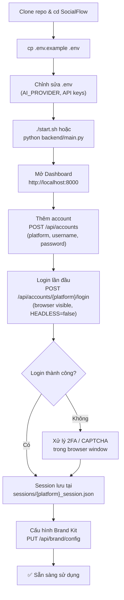
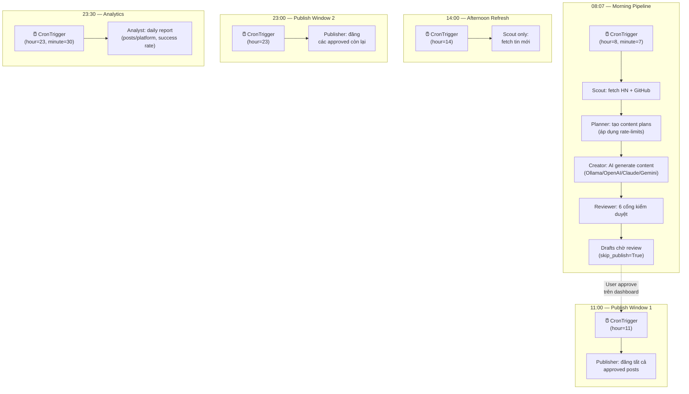
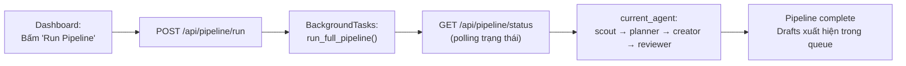
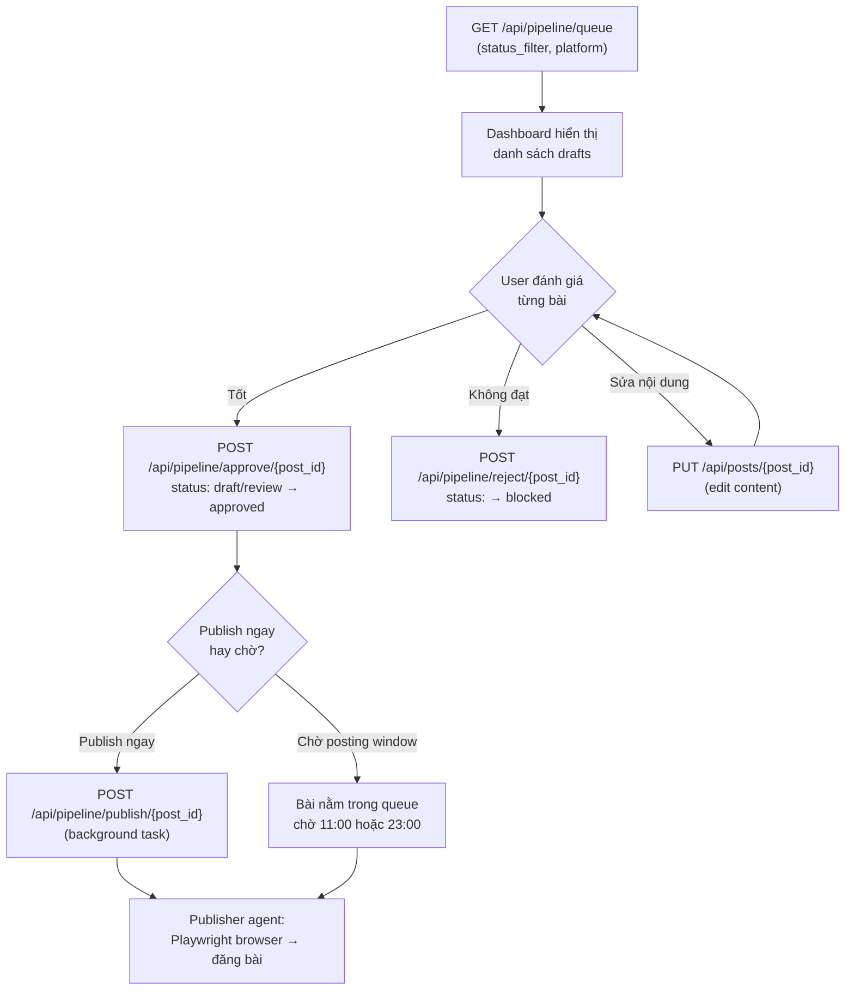
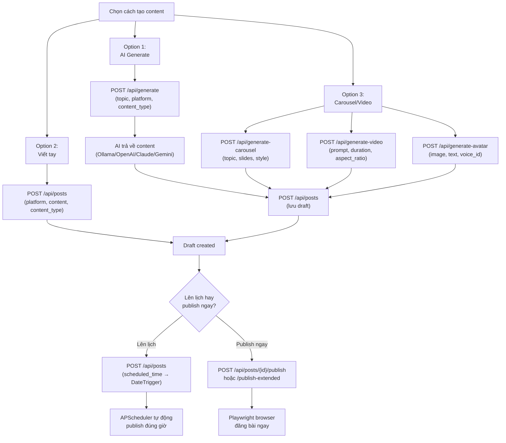
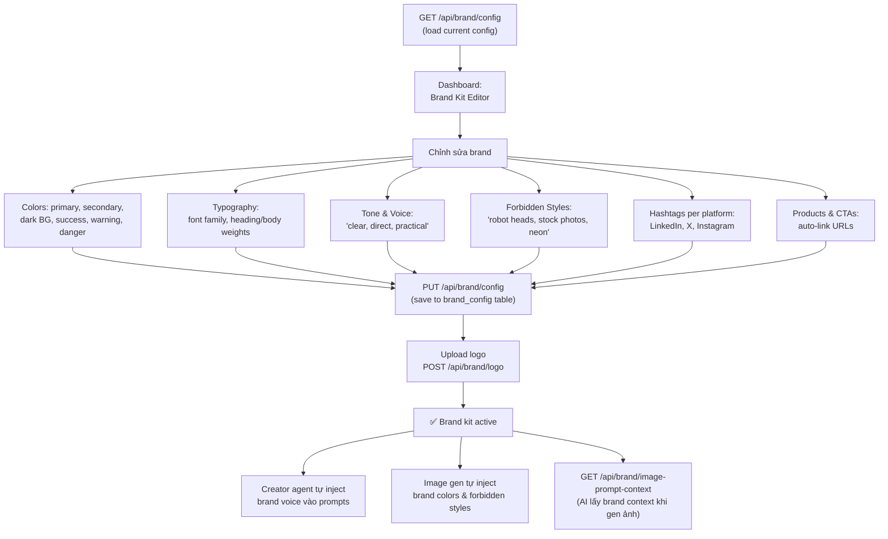
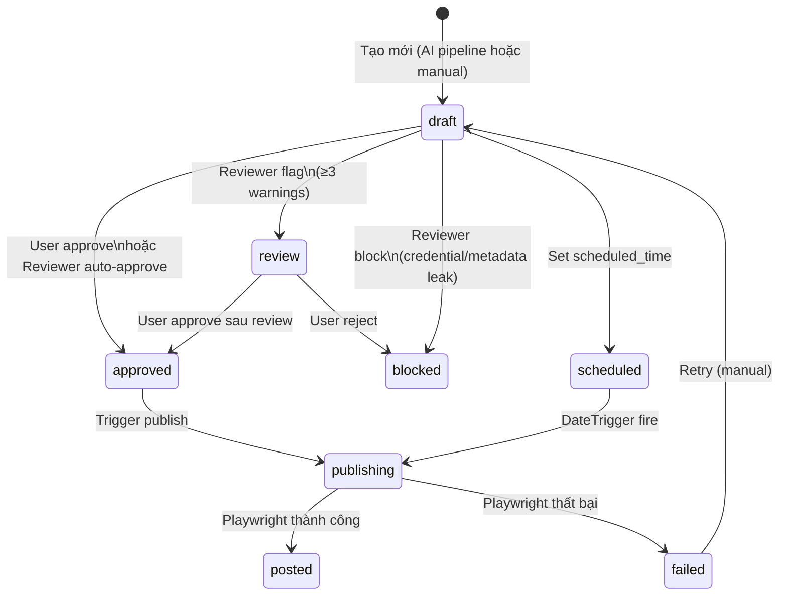
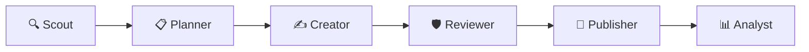

# PRD Summary — SocialFlow

> **AI-Powered Autonomous Social Media CMO**
> Version: 1.0 (derived from codebase audit)
> Author: InBharat AI • Repo: `inbharatai/SocialFlow`
> Last Audit: 2026-09-02

---

## 1. Product Overview

**SocialFlow** là một hệ thống tự động hoá social media hoàn toàn **self-hosted và open-source**, hoạt động như một "AI CMO" (Chief Marketing Officer). Hệ thống tự động thu thập tin tức, tạo nội dung, kiểm duyệt, đăng bài, và phân tích hiệu suất trên **12 nền tảng** — tất cả chạy trên máy cá nhân, không phụ thuộc cloud.

### Giá trị cốt lõi
| Thuộc tính | Mô tả |
|---|---|
| **Chi phí** | Miễn phí (Ollama local AI), chỉ trả ~$0.02/ảnh cho GPT Image |
| **Quyền riêng tư** | Mọi dữ liệu lưu trên máy, credentials mã hoá Fernet (AES-128-CBC) |
| **Tự động hoá** | Pipeline 6-agent chạy theo lịch, không cần can thiệp thủ công |
| **Mở rộng** | 12 platforms, 4 AI providers, bridge API cho pipeline bên ngoài |

---

## 2. Target Users

- **Solo founders / indie hackers** muốn tự động marketing trên nhiều nền tảng.
- **Startup teams nhỏ** không có ngân sách cho SaaS marketing tools ($29–99/tháng).
- **Developers / AI builders** muốn tự host và tùy biến pipeline.

---

## 3. Core Architecture

### 3.1. Tech Stack

| Layer | Technology |
|---|---|
| **Backend** | Python 3, FastAPI, SQLite, APScheduler |
| **Browser Automation** | Playwright (Chromium) |
| **AI Text** | Ollama (local, free) / OpenAI GPT-4o / Anthropic Claude / Google Gemini |
| **AI Image** | GPT Image 1.5 (OpenAI) |
| **AI Video** | Kling AI API, HeyGen (browser-based) |
| **Frontend** | Single-file React (`index.html`, ~104KB), Tailwind-inspired CSS |
| **Security** | Fernet encryption, local-only credentials, PII scanning |
| **Data** | SQLite (`socialflow.db`) — 12 tables |

### 3.2. Codebase Size

| Component | Files | Lines of Code |
|---|---|---|
| Backend (Python) | 11 files | ~5,028 LoC |
| Agents | 8 files (incl. `__init__.py`) | ~1,232 LoC |
| Frontend | 1 file | ~2,210 LoC |
| **Total** | **20 source files** | **~8,470 LoC** |

---

## 4. User Journeys

### 4.1. Journey 1 — First-Time Setup

> Người dùng mới cài đặt SocialFlow lần đầu và kết nối các nền tảng social media.



**Các bước thực tế trong code:**
1. `start.sh` tạo venv → install dependencies → `playwright install chromium` → chạy uvicorn
2. `lifespan()` trong [main.py](file:///Users/tuan/SocialFlow/backend/main.py#L670-L745) khởi tạo DB tables + APScheduler
3. Credentials mã hoá bằng Fernet trước khi lưu vào table `accounts`
4. Login mở browser thực (HEADLESS=false) để người dùng xử lý 2FA nếu cần
5. Session persist dưới dạng Playwright storage state (cookies + localStorage)

---

### 4.2. Journey 2 — Daily Autonomous Operation (Hands-off)

> Sau khi setup xong, hệ thống tự động chạy hàng ngày mà không cần can thiệp.



**Đặc điểm quan trọng:**
- Morning pipeline chạy với `skip_publish=True` → bài chỉ lên trạng thái `draft` hoặc `approved`, KHÔNG tự đăng
- User phải approve thủ công (hoặc Reviewer auto-approve nếu qua hết 6 cổng kiểm duyệt)
- 2 posting windows (11:00 + 23:00) chỉ publish các bài đã `approved`

---

### 4.3. Journey 3 — Manual Pipeline Trigger

> User chủ động trigger pipeline từ dashboard thay vì chờ lịch tự động.



**Chi tiết code:**
- API `POST /api/pipeline/run` chạy pipeline trong background task ([main.py#L800-L810](file:///Users/tuan/SocialFlow/backend/main.py#L800-L810))
- Nếu pipeline đang chạy → trả HTTP 409 Conflict
- Luôn `skip_publish=True` khi trigger manual — user quyết định publish sau

---

### 4.4. Journey 4 — Content Review & Approval

> User review các drafts do AI tạo ra, approve hoặc reject từng bài.



**Luồng trạng thái bài đăng:**
```
draft → approved → publishing → posted
  ↓        ↓                      ↓
review   blocked               failed
```

---

### 4.5. Journey 5 — Manual Content Creation

> User tự tạo nội dung (không qua pipeline tự động) và đăng lên platform.



**Hỗ trợ scheduling:**
- Nếu `scheduled_time` được set → APScheduler tạo `DateTrigger` tự publish đúng giờ ([main.py#L1420-L1427](file:///Users/tuan/SocialFlow/backend/main.py#L1420-L1427))
- Khi restart server, các scheduled posts được reschedule lại từ DB ([main.py#L720-L733](file:///Users/tuan/SocialFlow/backend/main.py#L720-L733))

---

### 4.6. Journey 6 — Brand Kit Configuration

> User cấu hình brand identity để AI tự áp dụng vào mọi content.



**Tác động của Brand Kit:**
- **Creator agent** ([creator.py#L80-L104](file:///Users/tuan/SocialFlow/backend/agents/creator.py#L80-L104)): Tự inject `tone`, `banned_phrases` vào AI prompt
- **Image generation** ([main.py#L357-L406](file:///Users/tuan/SocialFlow/backend/main.py#L357-L406)): Brand colors, forbidden styles ảnh hưởng image prompt
- **Reviewer agent** ([reviewer.py#L40-L51](file:///Users/tuan/SocialFlow/backend/agents/reviewer.py#L40-L51)): Kiểm tra brand voice violations

---

### Tổng quan Post Lifecycle (All Journeys)



---

## 5. 6-Agent Autonomous Pipeline

Pipeline xử lý tuần tự, được điều phối bởi [orchestrator.py](file:///Users/tuan/SocialFlow/backend/agents/orchestrator.py):



### Chi tiết từng Agent

| # | Agent | File | Chức năng chính |
|---|---|---|---|
| 1 | **Scout** | [scout.py](file:///Users/tuan/SocialFlow/backend/agents/scout.py) | Thu thập tin AI từ Hacker News API + GitHub repos (InBharat). Lọc theo 27 AI keywords, tính relevance score. Lưu signals vào SQLite. |
| 2 | **Planner** | [planner.py](file:///Users/tuan/SocialFlow/backend/agents/planner.py) | Đọc signals chưa xử lý → quyết định post lên platform nào, format gì. Áp dụng rate-limits (LinkedIn: 2/ngày, X: 5/ngày, Discord: 10/ngày). Tạo content plans. |
| 3 | **Creator** | [creator.py](file:///Users/tuan/SocialFlow/backend/agents/creator.py) | Lấy plans → dùng AI generate nội dung theo platform (LinkedIn: 500 chars, X: 270 chars, Discord: 300 chars...). Áp dụng brand voice, lọc 28 banned phrases ("game-changer", "delve"...). |
| 4 | **Reviewer** | [reviewer.py](file:///Users/tuan/SocialFlow/backend/agents/reviewer.py) | 6 cổng kiểm duyệt: credential leak scanning, metadata leak, fabricated claims, brand voice, length check, content validity. Auto-approve hoặc block/flag manual review. |
| 5 | **Publisher** | [publisher.py](file:///Users/tuan/SocialFlow/backend/agents/publisher.py) | Đăng bài qua Playwright browser automation hoặc Discord webhook. Quản lý session persistence, retry (max 2 lần). |
| 6 | **Analyst** | [analyst.py](file:///Users/tuan/SocialFlow/backend/agents/analyst.py) | Tổng hợp daily/weekly stats: posts/platform, success rate, signals fetched, plans created. |

### Lịch chạy tự động (APScheduler)

| Thời gian | Hành động |
|---|---|
| 08:07 | Full pipeline: Scout → Planner → Creator → Reviewer |
| 11:00 | Publish tất cả approved posts (không lọc platform) |
| 14:00 | Afternoon news refresh (Scout only) |
| 23:00 | Publish remaining approved posts |
| 23:30 | Daily analytics report |

---

## 6. Supported Platforms (12)

| Platform | Phương thức | Auth | File |
|---|---|---|---|
| LinkedIn | Playwright browser | Session persist | [automation.py](file:///Users/tuan/SocialFlow/backend/automation.py) |
| X / Twitter | Playwright browser | Session persist | [automation.py](file:///Users/tuan/SocialFlow/backend/automation.py) |
| Instagram | Playwright browser | Session persist | [automation.py](file:///Users/tuan/SocialFlow/backend/automation.py) |
| Facebook | Playwright browser | Session persist | [automation_extended.py](file:///Users/tuan/SocialFlow/backend/automation_extended.py) |
| Discord | Webhook (HTTP) | Webhook URL | [automation_extended.py](file:///Users/tuan/SocialFlow/backend/automation_extended.py) |
| Reddit | Playwright browser | Session persist | [automation_extended.py](file:///Users/tuan/SocialFlow/backend/automation_extended.py) |
| Medium | Playwright browser | Session persist | [automation_extended.py](file:///Users/tuan/SocialFlow/backend/automation_extended.py) |
| Substack | Playwright browser | Session persist | [automation_extended.py](file:///Users/tuan/SocialFlow/backend/automation_extended.py) |
| HeyGen | Playwright browser | Session persist | [heygen_adapter.py](file:///Users/tuan/SocialFlow/backend/heygen_adapter.py) |
| beehiiv | Playwright browser | Session persist | [automation_extended.py](file:///Users/tuan/SocialFlow/backend/automation_extended.py) |
| MailerLite | Playwright browser | Session persist | [automation_extended.py](file:///Users/tuan/SocialFlow/backend/automation_extended.py) |
| Brevo | Playwright browser | Session persist | [automation_extended.py](file:///Users/tuan/SocialFlow/backend/automation_extended.py) |

---

## 7. AI Integration

### 6.1. Text Generation (4 providers)

| Provider | Model | Chi phí | Config |
|---|---|---|---|
| **Ollama** (default) | qwen3:8b | FREE | `OLLAMA_URL`, `OLLAMA_MODEL` |
| OpenAI | GPT-4o | Pay-per-use | `OPENAI_API_KEY` |
| Anthropic | Claude Haiku 4.5 | Pay-per-use | `ANTHROPIC_API_KEY` |
| Google Gemini | Gemini 3.6 Flash | Free tier | `GEMINI_API_KEY` |

### 6.2. Image Generation

- **GPT Image 1.5** (thay thế DALL-E 3, rẻ hơn 75%: ~$0.015–0.020/ảnh)
- Brand-aware: tự inject brand colors, fonts, style rules
- Platform-optimized sizes (landscape cho LinkedIn/X, square cho IG)
- Carousel generation: 5-slide branded carousels via Pillow

### 6.3. Video Generation

- **Kling AI**: Text-to-video, Image-to-video (API-based)
- **HeyGen**: Avatar videos via browser automation — job lifecycle: `draft → queued → generating → completed → ready_for_distribution`

---

## 8. Data Model (SQLite)

Tất cả dữ liệu lưu trong [socialflow.db](file:///Users/tuan/SocialFlow/backend/socialflow.db):

| Table | Mô tả | Được tạo bởi |
|---|---|---|
| `posts` | Bài đăng (draft → approved → posted → failed) | main.py |
| `accounts` | Platform credentials (mã hoá Fernet) | main.py |
| `templates` | Content prompt templates | main.py |
| `signals` | Intelligence signals từ Scout | scout.py |
| `content_plans` | Content plans từ Planner | planner.py |
| `brand_config` | Brand kit (colors, fonts, tone, hashtags, products) | brand_kit.py |
| `assets` | Digital Asset Manager (videos, images, text) | asset_inventory.py |
| `content_queue` | Platform-specific distribution queue | asset_inventory.py |
| `campaigns` | Campaign grouping cho assets | asset_inventory.py |
| `post_metrics` | Per-post performance metrics | analytics_store.py |
| `weekly_metrics` | Aggregated weekly metrics | analytics_store.py |
| `content_insights` | Content type performance ranking | analytics_store.py |

---

## 9. API Surface (~60+ endpoints)

### Core Pipeline APIs (8 endpoints)
| Endpoint | Method | Description |
|---|---|---|
| `/api/pipeline/run` | POST | Trigger full autonomous pipeline |
| `/api/pipeline/status` | GET | Current pipeline state |
| `/api/pipeline/queue` | GET | Content queue (drafts, approved, posted) |
| `/api/pipeline/approve/{post_id}` | POST | Approve a draft post |
| `/api/pipeline/reject/{post_id}` | POST | Reject a post |
| `/api/pipeline/publish/{post_id}` | POST | Publish a specific post now |
| `/api/pipeline/signals` | GET | Intelligence signals from Scout |
| `/api/pipeline/analytics` | GET | Daily/weekly performance stats |

### Accounts & Auth (5 endpoints)
| Endpoint | Method | Description |
|---|---|---|
| `/api/accounts` | GET | List all platform accounts |
| `/api/accounts` | POST | Add platform credentials |
| `/api/accounts/{platform}/login` | POST | Login to platform via browser |
| `/api/accounts/{platform}/check` | POST | Check login status |
| `/api/accounts/{platform}` | DELETE | Remove platform account |

### Content Generation (6 endpoints)
| Endpoint | Method | Description |
|---|---|---|
| `/api/generate` | POST | AI text content generation |
| `/api/generate-carousel` | POST | Branded carousel pack (Pillow) |
| `/api/generate-video` | POST | Video generation (Kling AI) |
| `/api/video-status/{task_id}` | GET | Check video generation status |
| `/api/generate-reel` | POST | Short-form reel generation |
| `/api/generate-avatar` | POST | Avatar video (HeyGen) |

### Posts Management (6 endpoints)
| Endpoint | Method | Description |
|---|---|---|
| `/api/posts` | GET | List all posts |
| `/api/posts` | POST | Create a new post |
| `/api/posts/{post_id}` | PUT | Update a post |
| `/api/posts/{post_id}` | DELETE | Delete a post |
| `/api/posts/{post_id}/publish` | POST | Publish post now |
| `/api/posts/{post_id}/publish-extended` | POST | Publish to extended platforms |

### Brand Kit (4 endpoints)
| Endpoint | Method | Description |
|---|---|---|
| `/api/brand/config` | GET/PUT | Brand kit configuration |
| `/api/brand/logo` | POST | Upload brand logo |
| `/api/brand/colors` | GET | Brand color palette |
| `/api/brand/image-prompt-context` | GET | Brand context for AI image prompts |

### OpenClaw Bridge (4 endpoints)
| Endpoint | Method | Description |
|---|---|---|
| `/api/openclaw/publish` | POST | Push approved content to SocialFlow |
| `/api/openclaw/batch` | POST | Batch publish multiple items |
| `/api/openclaw/status` | GET | Platform connection status |
| `/api/openclaw/history` | GET | Recent publish history |

### Visual Content (5 endpoints)
| Endpoint | Method | Description |
|---|---|---|
| `/api/visual/types` | GET | Available brief types catalog |
| `/api/visual/generate` | POST | Generate visual brief |
| `/api/visual/auto-generate` | POST | Auto-generate from approved content |
| `/api/visual/briefs` | GET | List generated briefs |
| `/api/visual/stats` | GET | Visual content statistics |

### HeyGen Video (13 endpoints)
| Endpoint | Method | Description |
|---|---|---|
| `/api/heygen/jobs` | POST/GET | Create/list HeyGen video jobs |
| `/api/heygen/jobs/{job_id}` | GET | Get job details |
| `/api/heygen/jobs/{job_id}/generate` | POST | Start video generation |
| `/api/heygen/jobs/{job_id}/register-output` | POST | Register completed output |
| `/api/heygen/jobs/{job_id}/distribute` | POST | Distribute to platforms |
| `/api/heygen/platform-rules` | GET | Platform distribution rules |
| `/api/heygen/platform-rules/{platform}` | GET | Rules for specific platform |
| `/api/heygen/assets` | GET | List video assets |
| `/api/heygen/assets/{asset_id}` | GET | Get specific asset |
| `/api/heygen/queue` | GET | Distribution queue |
| `/api/heygen/queue/{queue_id}/approve` | POST | Approve queue item |
| `/api/heygen/queue/{queue_id}/publish` | POST | Publish queue item |

### Analytics (5 endpoints)
| Endpoint | Method | Description |
|---|---|---|
| `/api/analytics/metrics` | POST | Submit post metrics |
| `/api/analytics/platform/{platform}` | GET | Platform-specific analytics |
| `/api/analytics/top-content-types` | GET | Top performing content types |
| `/api/analytics/pillars` | GET | Content pillar performance |
| `/api/analytics/weekly-summary` | GET | Weekly summary report |

### Infrastructure (5 endpoints)
| Endpoint | Method | Description |
|---|---|---|
| `/` | GET | Serve frontend dashboard |
| `/api/health` | GET | Server health check |
| `/api/config` | GET/POST | Server configuration |
| `/api/upload` | POST | File upload |
| `/docs` | GET | Interactive Swagger API docs |

---

## 10. Security Model

| Aspect | Implementation |
|---|---|
| **Credential Storage** | Fernet (AES-128-CBC) encryption — key auto-generated in `.secret_key` |
| **Session Persistence** | Playwright browser storage state in local `sessions/` directory |
| **Pre-publish Scanning** | Reviewer agent scans for API keys, tokens, PII, metadata leaks |
| **Credential Patterns** | 5 regex patterns: OpenAI keys, GitHub tokens, Slack tokens, email+password |
| **Brand Compliance** | 10 brand violation patterns, 28 banned AI-generated phrases |
| **Data Locality** | Everything local — no external cloud storage, no credential transmission |

---

## 11. Brand Kit System

Configurable từ dashboard, áp dụng tự động vào content generation:

- **Visual Identity**: Colors (primary, secondary, dark BG, success, warning, danger), Logo, Typography (font family, weights)
- **Voice & Tone**: Configurable tone guidelines, forbidden styles cho image generation
- **Platform-Specific**: Hashtag presets per platform (LinkedIn, X, Instagram)
- **Products**: Auto-link insertion cho product URLs (InBharat AI, Phoring, UniAssist, Testsprep, Sahaayak AI, CodeIn)
- **CTA Templates**: Reusable call-to-action templates

---

## 12. External Integration — OpenClaw Bridge

[openclaw_bridge.py](file:///Users/tuan/SocialFlow/backend/openclaw_bridge.py) cung cấp API bridge cho pipeline bên ngoài (OpenClaw):

- **POST** `/api/openclaw/publish` — Push approved content vào SocialFlow
- **POST** `/api/openclaw/batch` — Push multiple items cùng lúc
- **GET** `/api/openclaw/status` — Kiểm tra platform connection
- **GET** `/api/openclaw/history` — Lịch sử publish gần đây
- Hỗ trợ `dry_run` mode, audit trail với `approval_level` (L1/L2/L3)

---

## 13. Frontend

- **Single-file React app**: [index.html](file:///Users/tuan/SocialFlow/frontend/index.html) (~104KB, ~2,210 LoC)
- Dashboard hiển thị: pipeline status, content queue, signals, analytics, brand kit config
- Served trực tiếp bởi FastAPI static files

---

## 14. Deployment

- **Local-first**: Chạy trên máy cá nhân (`python main.py` hoặc `./start.sh`)
- **Server**: Uvicorn with `--reload`, port 8000
- **Dependencies**: 10 Python packages (FastAPI, Playwright, Pillow, cryptography, httpx, apscheduler...)
- **Headless mode**: `HEADLESS=true` cho server deployment (không cần browser GUI)

---

## 15. Gaps & Improvement Opportunities

> [!NOTE]
> Những điểm nhận diện được trong quá trình audit codebase, có thể là cơ hội cải thiện:

| # | Area | Observation |
|---|---|---|
| 1 | **SRP Violation** | `main.py` có **1,609 dòng** — chứa cả config, DB init, models, AI generation, image gen, video gen, tất cả API routes. Cần tách thành modules. |
| 2 | **No Tests** | Không có test nào trong repo — cần unit tests cho agents, automation, và API endpoints. |
| 3 | **No CI/CD** | Không có GitHub Actions, Docker, hay deployment automation. |
| 4 | **Hardcoded Brand** | Brand name "InBharat AI" hardcoded ở nhiều nơi (Discord bot username, default configs). |
| 5 | **RSS Feeds** | Scout chỉ fetch Hacker News + GitHub — chưa implement RSS feed scanning (mặc dù đề cập trong README). |
| 6 | **Duplicate Import** | `reviewer.py` có `import json` ở cả đầu file và cuối file (dòng 163). |
| 7 | **Error Handling** | Một số chỗ dùng bare `except Exception` mà không log chi tiết. |
| 8 | **No Rate Limiting** | API endpoints không có rate limiting protection. |
| 9 | **Frontend Monolith** | Toàn bộ frontend nằm trong 1 file HTML ~104KB (~2,210 LoC) — khó maintain khi scale. |
| 10 | **No Migration System** | SQLite schema thay đổi bằng `CREATE IF NOT EXISTS` — không có migration versioning. |

---

## 16. File Map

```
SocialFlow/
├── .env.example                    # Environment config template
├── README.md                       # Main documentation
├── SOCIALFLOW-README.md            # Short platform overview
├── start.sh                        # Startup script
├── backend/
│   ├── main.py                     # FastAPI server (1,609 LoC) — API, AI, config
│   ├── automation.py               # Core browser automation (LinkedIn, X, Instagram)
│   ├── automation_extended.py      # Extended platforms (Facebook, Discord, Reddit, Medium...)
│   ├── heygen_adapter.py           # HeyGen video generation adapter
│   ├── heygen_routes.py            # HeyGen API routes
│   ├── brand_kit.py                # Brand configuration API
│   ├── openclaw_bridge.py          # External pipeline bridge API
│   ├── analytics_store.py          # Post-publish performance tracking
│   ├── asset_inventory.py          # Digital asset management
│   ├── visual_content_routes.py    # Visual content generation API
│   ├── requirements.txt            # Python dependencies (10 packages)
│   ├── socialflow.db               # SQLite database
│   ├── sessions/                   # Browser session storage
│   ├── uploads/                    # Generated media files
│   └── agents/
│       ├── __init__.py             # Package init (empty)
│       ├── orchestrator.py         # Pipeline coordinator
│       ├── scout.py                # News/trend intelligence
│       ├── planner.py              # Content strategy
│       ├── creator.py              # Content production
│       ├── reviewer.py             # Quality & compliance gates
│       ├── publisher.py            # Distribution engine
│       └── analyst.py              # Performance analytics
└── frontend/
    └── index.html                  # React dashboard (single file)
```
