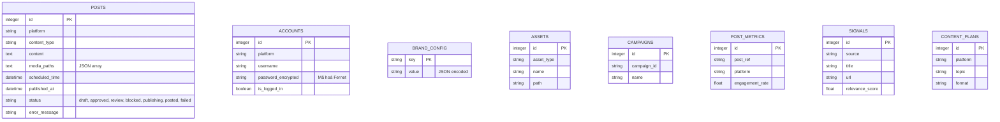

# SocialFlow Technical Reference

> Tài liệu kỹ thuật chuyên sâu phản ánh chính xác cấu trúc và cơ chế hoạt động của mã nguồn SocialFlow hiện tại (As-Is).

## 1. System Architecture

SocialFlow được xây dựng trên kiến trúc nguyên khối (monolithic), với FastAPI là trung tâm điều phối mọi hoạt động từ API, phục vụ UI tĩnh, AI Generation cho đến Browser Automation.

### 1.1. Application Lifecycle
1. **Khởi tạo (Lifespan Context)**: Khi server Uvicorn khởi động, `lifespan()` trong [main.py](file:///Users/tuan/SocialFlow/backend/main.py#L670-L745) được gọi để:
   - Tạo các bảng SQLite bằng các lệnh `CREATE TABLE IF NOT EXISTS` (hiện không có framework migration).
   - Khởi chạy `AsyncIOScheduler` (từ thư viện APScheduler).
   - Đăng ký các CronTrigger cho các khung giờ cố định (08:07 cho Agent pipeline, 11:00/23:00 cho Publishing, 23:30 cho Analytics).
   - Truy xuất các bài đăng có trạng thái `scheduled` từ database và gắn DateTrigger để chờ phát hành đúng hẹn.

2. **Xử lý Request**:
   - Các API endpoints xử lý đồng bộ/bất đồng bộ trực tiếp business logic.
   - Các task nặng (như pipeline generation, publish lên platform qua trình duyệt) được đẩy vào `FastAPI BackgroundTasks` để giải phóng main thread của server.

### 1.2. Thư mục và Persistence
- Dữ liệu quan hệ: `socialflow.db` (SQLite file).
- Phiên đăng nhập (Cookies/Storage State): Lưu tại thư mục `sessions/` dưới định dạng JSON (VD: `sessions/linkedin_session.json`).
- Tài nguyên tĩnh (Hình ảnh/Video): Lưu tại thư mục `uploads/` và được serve thông qua FastAPI `StaticFiles` mount.

---

## 2. Database Schema & Data Models

Tất cả 12 bảng đều nằm chung trong file SQLite `socialflow.db`.



### Chi tiết kỹ thuật các bảng quan trọng:
- **`accounts`**: Mật khẩu được mã hoá bằng thuật toán đối xứng Fernet (AES-128-CBC). Key giải mã được tự động sinh ra và lưu tĩnh tại `.secret_key` trong lần khởi chạy đầu tiên.
- **`posts`**: Trường `media_paths` lưu chuỗi JSON stringified. Cột `status` đóng vai trò là cột mốc cho state machine điều khiển vòng đời bài viết.
- **`brand_config`**: Lưu trữ dạng EAV linh hoạt (`key`, `value`), trong đó `value` thường là một object JSON serialize (ví dụ: array màu sắc, object quy định typography).

---

## 3. Agent Architecture & Prompt Injection

Hệ thống sử dụng mô hình tuần tự (Chain of Agents) được quản lý và gọi liên tiếp bởi hàm `run_full_pipeline()` trong [orchestrator.py](file:///Users/tuan/SocialFlow/backend/agents/orchestrator.py). Hệ thống không sử dụng middleware trừu tượng (như LangChain) mà gọi LLM API trực tiếp (Ollama, OpenAI, Claude, Gemini).

### 3.1. Context & Tone Injection
[creator.py](file:///Users/tuan/SocialFlow/backend/agents/creator.py) chịu trách nhiệm xây dựng Prompt sinh nội dung. Trước khi request LLM, nó sẽ:
1. Đọc cấu hình từ bảng `brand_config` (tone guidelines, hashtags).
2. Nối chuỗi (concatenate) các quy định này vào System Prompt.
3. Chèn động danh sách `BANNED_PHRASES` (28 cụm từ AI sáo rỗng như "game-changer", "delve") và ra lệnh nghiêm ngặt để LLM không sử dụng chúng.

### 3.2. Cổng kiểm duyệt (Reviewer Agent)
[reviewer.py](file:///Users/tuan/SocialFlow/backend/agents/reviewer.py) không dùng LLM để kiểm duyệt (nhằm tiết kiệm chi phí và tăng tốc độ, ngoại trừ hàm check content validity), mà hoàn toàn dùng Regex Pattern Matching:
- `CREDENTIAL_PATTERNS`: (5 patterns) Quét API keys, tokens rò rỉ.
- `BRAND_VIOLATIONS`: (10 patterns) Quét các từ ngữ vi phạm brand voice.
- `METADATA_PATTERNS`: (7 patterns) Quét các JSON format tags (```json), log metadata bị dính vào output.
- `FABRICATION_PATTERNS`: (4 patterns) Bắt lỗi "ảo giác" (hallucinations), điển hình như bịa số liệu "95% improvement", "millions of users".

**Quy tắc ra quyết định**:
- Vi phạm Credential/Metadata -> trạng thái `blocked` (từ chối ngay lập tức).
- Vi phạm Fabricated/Brand -> ghi nhận vào mảng `warnings`. Nếu ≥ 3 warnings -> đổi trạng thái thành `review` để chờ người dùng duyệt thủ công.

---

## 4. Browser Automation Mechanism

SocialFlow sử dụng **Playwright** (module Chromium) để thao tác DOM, bypass API rate-limits và paywalls của các mạng xã hội.

### 4.1. Factory Pattern Resolution
Hàm `get_automation_extended(platform, headless)` trong [automation_extended.py](file:///Users/tuan/SocialFlow/backend/automation_extended.py#L755) sử dụng dictionary mapping để mapping `platform` string vào instance class tương ứng (ví dụ: `LinkedInAutomation`, `FacebookAutomation`). Các class này đều kế thừa base class `SocialAutomation`.

### 4.2. Storage State & Human-in-the-loop Fallback
- Khi gọi hàm `.login()`, hệ thống khởi tạo trình duyệt dạng GUI hiển thị (`headless=False`).
- Bot sẽ điền Username/Password và submit. Sau đó lặp `wait_for_timeout()`.
- **Anti-bot Handling**: Nếu URL chuyển hướng có chứa các từ khóa như `challenge`, `checkpoint`, `auth_platform/recaptcha/` (ví dụ ở Instagram/LinkedIn), mã nguồn sẽ rơi vào vòng lặp chờ (`timeout=120000` / 2 phút) và in log ra console. Hệ thống nhường quyền lại cho người dùng thao tác trực tiếp trên trình duyệt để **tự giải mã CAPTCHA hoặc nhập mã 2FA**.
- Khi thành công, Playwright `context.storage_state()` lưu lại toàn bộ cookie và local storage vào file JSON.
- Ở các lần `.post()` tiếp theo, trình duyệt chạy ngầm ngầm (`headless=True`) và chỉ cần truyền file session này vào context là có thể thao tác với tư cách người dùng hợp lệ mà không cần đăng nhập lại.

---

## 5. API Integration Details

Các FastAPI routes được chia nhóm logic qua các router file riêng lẻ (VD: `openclaw_bridge.py`, `heygen_routes.py`) và được mount vào core app bằng `app.include_router()` tại `main.py`.

### 5.1. OpenClaw Bridge API
Các pipeline bên ngoài (như OpenClaw) có thể tự động bơm nội dung vào kho của SocialFlow thông qua endpoint `POST /api/openclaw/publish` ([openclaw_bridge.py](file:///Users/tuan/SocialFlow/backend/openclaw_bridge.py#L60)).
- Hỗ trợ concept `approval_level`: `L1` (Low risk) sẽ tự động lưu `status='approved'`, trong khi `L2/L3` (High risk) sẽ ép `status='review'` để người thực duyệt.
- Hỗ trợ cờ `dry_run=true` để validator kiểm thử format payload mà không ghi DB.

### 5.2. Video Generation Polling (Kling AI)
Tích hợp Kling AI API yêu cầu xử lý bất đồng bộ kéo dài. Trong [main.py](file:///Users/tuan/SocialFlow/backend/main.py#L1134-L1179), ứng dụng sẽ trigger task sinh video rồi rơi vào block `while True` với `await asyncio.sleep(10)` (pooling). Sau mỗi 10 giây, code thực hiện GET request để kiểm tra trạng thái video. Nếu completed, tải file `mp4` xuống ổ đĩa, lưu vào DB và gọi trigger đăng bài. Mọi quá trình này được lock trong BackgroundTasks của FastAPI.
